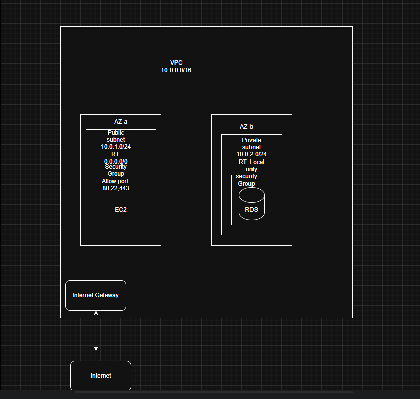

# AWS Cloud Bootcamp — Lab 2: Networking Fundamentals

## What This Is

This is my personal study work as I learn AWS from scratch. This lab covers
building a custom VPC with public and private subnets, routing, and security
groups using the AWS Console.

**Level:** Beginner (some IT background)
**Interface:** AWS Console
**Goal:** Understand how AWS networking works before touching any other service

---

## What I Built

A VPC network from scratch with the following components:

| Component | Setting | Purpose |
|---|---|---|
| VPC `bootcamp-vpc` | 10.0.0.0/16 | Isolated private network |
| Public subnet | 10.0.1.0/24 in AZ-a | For internet-facing resources |
| Private subnet | 10.0.2.0/24 in AZ-b | For backend resources like databases |
| Internet Gateway | Attached to VPC | The door to the internet |
| Public route table | 0.0.0.0/0 → IGW | What actually makes the public subnet public |
| Security group `web-sg` | Allow ports 22, 80, 443 | Firewall attached to the EC2 instance |

---

## Architecture



<details>
<summary>ASCII version</summary>

```
┌──────────────────────────────────────────────────────────┐
│  VPC: bootcamp-vpc (10.0.0.0/16)                         │
│                                                          │
│  ┌───────────────────────┐  ┌────────────────────────┐  │
│  │ AZ-a                  │  │ AZ-b                   │  │
│  │ Public Subnet         │  │ Private Subnet         │  │
│  │ 10.0.1.0/24           │  │ 10.0.2.0/24            │  │
│  │ RT: 0.0.0.0/0 → IGW  │  │ RT: local only         │  │
│  │                       │  │                        │  │
│  │ ┌───────────────────┐ │  │ ┌──────────────────┐   │  │
│  │ │ SG: web-sg        │ │  │ │ SG: db-sg        │   │  │
│  │ │ ┌───────────────┐ │ │  │ │ ┌──────────────┐ │   │  │
│  │ │ │ EC2 (web)     │ │ │  │ │ │ RDS (db)     │ │   │  │
│  │ │ └───────────────┘ │ │  │ │ └──────────────┘ │   │  │
│  │ └───────────────────┘ │  │ └──────────────────┘   │  │
│  └───────────────────────┘  └────────────────────────┘  │
│                                                          │
│               ┌──────────────────┐                      │
│               │ Internet Gateway │                      │
│               └──────────────────┘                      │
└───────────────────────────┬──────────────────────────────┘
                            │
                        Internet
```

</details>

---

## Key Things I Learned

**A subnet is not public just because of its name.**
It needs a route table entry pointing to the Internet Gateway, and resources
inside need public IPs assigned. Both have to be true.

**Attaching an IGW to a VPC is not enough on its own.**
The IGW is just the door. The route table is the signpost that tells traffic
to use that door. Without `0.0.0.0/0 → IGW` in the route table, packets have
no instructions and get dropped.

**Security Groups are stateful.**
Stateful means AWS tracks the connection — if a request comes in on port 80
and is allowed, the reply going back out is automatically permitted. You don't
need a separate outbound rule for return traffic. NACLs work the opposite way
(stateless) — they don't track connections, so you need explicit rules for
both directions.

**Important: stateful/stateless here is about network connections, not application design.**
The same words are used in a completely different context when talking about
application architecture. There, stateful means a server remembers a user's
session locally; stateless means the server holds nothing and session data
lives in shared storage. Same words, two different layers — network traffic
vs application sessions. The context always makes clear which one is meant.

**The Internet Gateway lives inside the VPC, not outside it.**
AWS says "attached to VPC" which confused me at first. The IGW is inside the
VPC boundary but not inside any subnet. It sits at the VPC edge.

**Private subnets can still talk to the public subnet internally.**
Private just means no direct internet access — it does not mean isolated from
everything. A web server in the public subnet can still query a database in
the private subnet through the VPC's local route.

**CIDR /number tells you how many bits are fixed.**
The free bits are 32 minus that number. /16 = 16 fixed, 16 free = 65,536
addresses. /24 = 24 fixed, 8 free = 256 addresses. The VPC gets /16 so there
is room to carve out many subnets. Subnets get /24 as a manageable slice of
that space.

**AWS always reserves 5 IP addresses in every subnet — always.**
This is easy to forget when calculating usable IPs. A /24 gives you 256
addresses total, but only 251 are usable. The 5 reserved are:

| Address | Example (10.0.1.0/24) | Reserved For |
|---|---|---|
| 1st | 10.0.1.0 | Network address — identifies the subnet itself |
| 2nd | 10.0.1.1 | VPC router — your default gateway |
| 3rd | 10.0.1.2 | AWS DNS server |
| 4th | 10.0.1.3 | Reserved by AWS for future use |
| Last | 10.0.1.255 | Broadcast address |

So the rule is: **total addresses minus 5 = usable IPs**. Always factor this
in when planning subnets — if you need 256 hosts, a /24 won't be enough,
you'll need a /23 (512 addresses, 507 usable).

---

## What Confused Me Initially

- Where the IGW sits — I initially drew it outside the VPC, but it belongs
  inside the VPC boundary (just not inside any subnet)
- The difference between stateful and stateless — I thought stateful just
  meant allow-only, but it actually means connection tracking
- Why attaching the IGW alone does nothing — had to understand that the route
  table is a separate, required step

---

## Files in This Lab

| File | What It Is |
|---|---|
| `README.md` | This file — summary and reflections |
| `networking-fundamentals-lab.md` | Full concept notes and step-by-step lab walkthrough |

---

## Lab Status

- [x] Concepts studied and understood before starting
- [x] Architecture diagram drawn manually before touching the console
- [x] Lab completed in AWS Console
- [x] Verification checklist passed
- [x] Resources cleaned up

---

*Part of my AWS Cloud Bootcamp — see the root README for all labs.*
