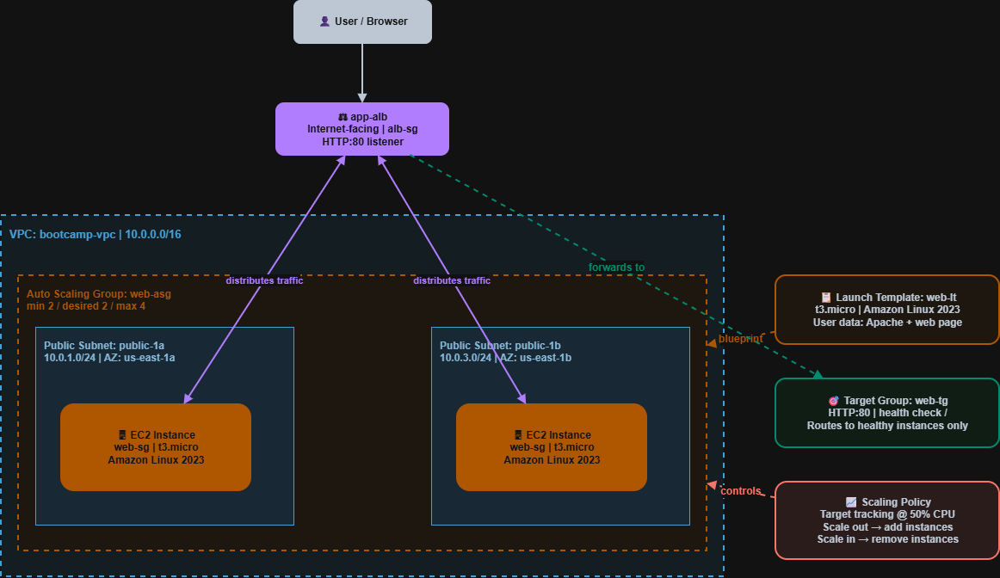

# AWS Cloud Bootcamp — Lab 5: Scalable, Load-Balanced Web App

## What This Is

This is my personal study work as I learn AWS from scratch. This lab builds on
the single EC2 instance from Lab 3 and turns it into a resilient, elastic web
tier using a Launch Template, Application Load Balancer, and Auto Scaling Group
— all from the AWS Console.

**Level:** Some IT background  
**Interface:** AWS Console  
**Goal:** Understand how to make a web tier highly available, self-healing, and scalable

---

## What I Built

| Component | Setting | Purpose |
|---|---|---|
| Subnet `public-1b` | 10.0.3.0/24, AZ-b | Second AZ required for ALB and ASG |
| Security group `alb-sg` | HTTP:80 from anywhere | ALB-specific security group |
| Launch template `web-lt` | Amazon Linux 2023, t3.micro, user data | Blueprint for every ASG instance |
| Target group `web-tg` | HTTP:80, health check / | Pool of instances receiving traffic |
| Load balancer `app-alb` | Internet-facing, both public subnets | Single entry point for all traffic |
| Auto Scaling Group `web-asg` | min 2 / desired 2 / max 4, two AZs | Self-healing, elastic instance fleet |
| Scaling policy | Target tracking at 50% CPU | Automatic scale-out and scale-in |
| Colour instances | green / yellow / blue | Visual proof of round-robin load balancing |

---

## Architecture



<details>
<summary>ASCII version</summary>

```
                        Internet
                            │
                    ┌───────────────┐
                    │   app-alb     │  Internet-facing ALB
                    │   (alb-sg)    │  HTTP:80 listener
                    └───────────────┘
                      │           │
            ┌─────────┘           └─────────┐
            ▼                               ▼
┌─────────────────────┐         ┌─────────────────────┐
│   public-1a (AZ-a)  │         │   public-1b (AZ-b)  │
│   EC2 instance      │         │   EC2 instance      │
│   (web-sg)          │         │   (web-sg)          │
└─────────────────────┘         └─────────────────────┘
            └──────────────┬──────────────┘
                           ▼
                    ┌─────────────┐
                    │   web-tg    │  Target Group
                    └─────────────┘
                           │
                    ┌─────────────┐
                    │   web-lt    │  Launch Template (blueprint)
                    └─────────────┘
```

</details>

---

## Key Things I Learned

**A launch template ensures every instance the ASG creates is identical.**  
Hand-built instances accumulate drift over time — different software versions,
manual changes, inconsistent config. A launch template bakes everything in at
launch so the fleet is always consistent and reproducible.

**The ALB is the single entry point — instances should never be hit directly.**  
Locking `web-sg` to only accept traffic from `alb-sg` enforces this. Even if
an instance has a public IP, port 80 is only open to the ALB. All traffic must
flow through the load balancer — this is defense in depth.

**Self-healing is automatic — the ASG replaces unhealthy instances without any action.**  
Terminating an instance manually proved this. The ASG detected the missing
instance and launched a replacement within about a minute. In production this
means a failed server recovers without waking anyone up at 3am.

**ELB health checks catch failures that EC2 health checks miss.**  
EC2 checks only detect a dead VM. If Apache crashes but the instance is still
running, EC2 sees it as healthy. ELB health checks send HTTP requests — if
the web server doesn't respond, the instance is marked unhealthy and taken out
of rotation. Always enable ELB health checks for web tiers.

**Target tracking scaling works like a thermostat.**  
Set a target (50% CPU) and the ASG adds or removes instances to maintain it.
It doesn't react instantly — CloudWatch needs several data points before
acting, by design, to avoid thrashing. Patience while watching it scale is normal.

**Spreading across two AZs means one data centre failing doesn't take the app down.**  
With instances in AZ-a and AZ-b, if one AZ has an outage the other keeps
serving traffic. The ALB automatically stops routing to the affected AZ.
This is the foundation of high availability in AWS.

**Round-robin is the default — stickiness is the exception.**  
Without stickiness the ALB distributes each request to the next healthy
instance in rotation. The colour demo made this visual and immediate — watching
GREEN → YELLOW → BLUE on every refresh was the clearest possible proof.
Stickiness should only be used when instances hold local session state,
and even then it is a short-term fix. Stateless instances with shared session
storage (ElastiCache or DynamoDB) is the scalable long-term pattern.

**Cleanup order matters — dependencies must be broken before deleting.**  
A security group cannot be deleted while a resource uses it. A target group
cannot be deleted while a listener forwards to it. Deleting in the wrong order
produces errors. The correct order is always top-down: instances → ASG → ALB
→ target group → launch template → security groups.

---

## What Confused Me Initially

- Why the launch template has no subnet — the subnet is intentionally left out
  so the ASG can choose the right AZ for each instance it launches
- Why the ALB needs its own security group separate from web-sg — the ALB
  and the instances are different resources with different traffic rules.
  The ALB faces the internet; the instances should only face the ALB
- Why scaling isn't instant — it felt like a delay but it's deliberate.
  Reacting to a single CPU spike would cause thrashing; CloudWatch averages
  over multiple data points before the ASG acts

---

## Key Concepts

**1. Launch template vs hand-built instance** — a launch template is a
repeatable blueprint. Every instance the ASG creates from it is identical.
Hand-built instances drift over time and cannot be reliably reproduced.

**2. Listener, target group, health check** — the listener receives traffic
on a port and forwards it to a target group. The target group is the pool of
instances. Health checks continuously verify each instance is actually serving
requests — unhealthy instances are removed from rotation automatically.

**3. Defense in depth with security groups** — locking web-sg to only accept
traffic from alb-sg means the ALB is the only path to the instances. Direct
access to instance IPs on port 80 is blocked regardless of whether the instance
has a public IP.

**4. EC2 vs ELB health checks** — EC2 checks detect a dead VM. ELB checks
detect a failed web server. A running instance with a crashed web server passes
EC2 checks but fails ELB checks. Always use ELB health checks for web tiers.

**5. Two ways to handle session state** — stickiness (pin the client to one
instance with a cookie) or stateless instances with shared storage. Stickiness
is the quick fix; shared storage (ElastiCache, DynamoDB) is the scalable
long-term pattern.

**6. Why target tracking scaling is not instant** — CloudWatch aggregates CPU
metrics over time. Acting on a single data point would cause thrashing — rapid
scale-out and scale-in that wastes money and destabilises the fleet. The delay
is intentional.

**7. Deletion order** — always delete top-down. Remove what uses a resource
before removing the resource itself. ASG first (terminates instances), then
ALB, then target group, then launch template, then security groups.

---

## Files in This Lab

| File | What It Is |
|---|---|
| `README.md` | This file — summary and reflections |
| `scalable-web-app-lab.md` | Full concept notes and step-by-step lab walkthrough |

---

## Lab Status

- [x] Second public subnet added — ALB and ASG span two AZs
- [x] Launch template `web-lt` created with user data web server
- [x] `alb-sg` created; `web-sg` locked to only accept traffic from `alb-sg`
- [x] Target group `web-tg` created with health checks
- [x] Internet-facing ALB `app-alb` with HTTP:80 forwarding to `web-tg`
- [x] ASG `web-asg` (min 2 / max 4) across two AZs with ELB health checks
- [x] Target tracking scaling policy at 50% CPU
- [x] Self-healing confirmed — terminated instance replaced automatically
- [x] Round-robin confirmed with colour instances
- [x] Stickiness confirmed — traffic pinned after enabling
- [x] Entire stack torn down

---

*Part of my AWS Cloud Bootcamp — see the root [README](../README.md) for all labs.*
